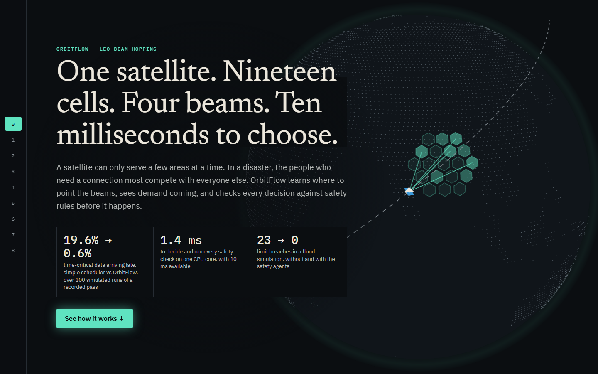
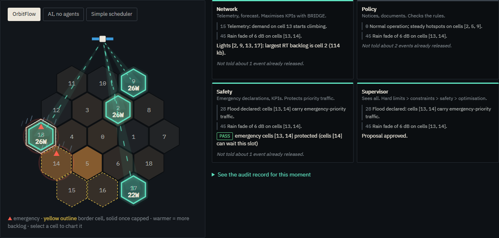
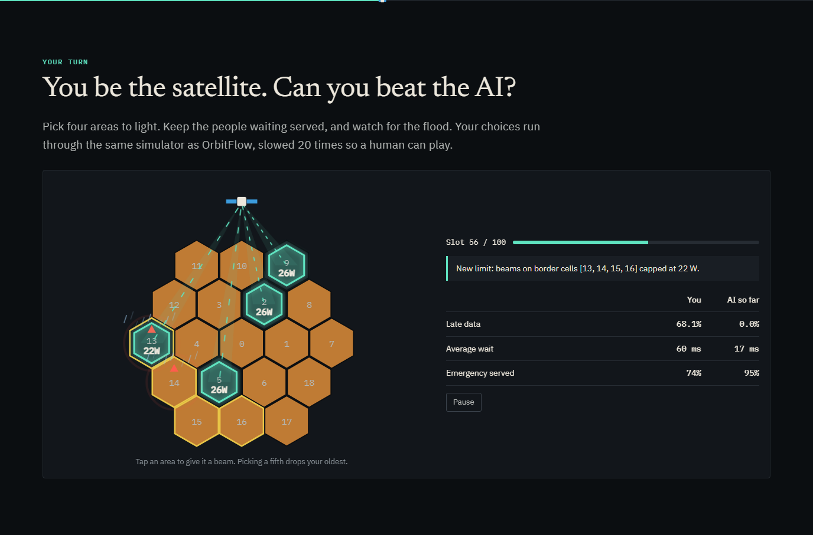
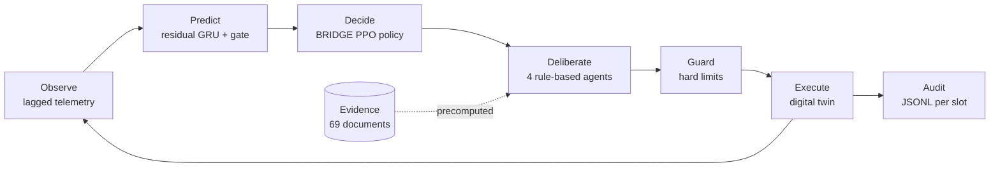

# OrbitFlow

**Learned, safety-checked beam hopping for a LEO satellite, with every decision audited.**

[](#testing)
[](https://www.python.org/)
[](https://pytorch.org/)
[](https://react.dev/)
[](LICENSE)

A satellite can light only 12 of its 58 ground cells in each 10 ms slot, on a 300 W budget, over three regional clusters covering about 163 km². During a disaster, the people who most need a link compete with everyone else under the footprint.

OrbitFlow forecasts demand, chooses beams with a reinforcement-learned policy, and checks each decision against hard limits and operating constraints before it runs. Every slot is written to an audit log, and rule evidence is quoted word for word from real ITU and FCC documents.

> OrbitFlow is a research simulation built on offline datasets. It does not connect to a satellite or run in a live network.

> **Version 3** targets the revised 58-cell dataset (12 beams, 300 W). The 19-cell, 4-beam setup and its results are archived in `data/legacy_19cell/`, `models/legacy_19cell/` and `results/legacy_19cell/`; see [docs/REPORT.md](docs/REPORT.md) for both.



## Contents

- [Key results](#key-results)
- [Quick start](#quick-start)
- [What's in the app](#whats-in-the-app)
- [How it works](#how-it-works)
- [API](#api)
- [Reproducing the results](#reproducing-the-results)
- [Testing](#testing)
- [Project layout](#project-layout)
- [Configuration](#configuration)
- [Documentation](#documentation)
- [References](#references)

## Key results

Measured on 100 paired test episodes, averaged over 5 independently trained models. None of these episodes were used in training or model selection.

**Read this first.** In the 58-cell pass, cells have line of sight in only 36% of cell-slots, and a cell without it cannot be decoded by any beam. About 97% of late time-critical data comes from those moments, so every competent scheduler sits near 12–13% total lateness. The first column counts only late data that a beam *could* have delivered; that is where scheduling choices show.

| Recorded pass | Late data a beam could have served | All late time-critical data | Mean delay | Throughput | Beam switches per slot |
|---|---:|---:|---:|---:|---:|
| Fixed rotation | 36.27% | 38.0% | 128.6 ms | 830 Mbps | 11.54 |
| Reactive greedy | 1.35% | 12.7% | 81.8 ms | 1256 Mbps | 7.20 |
| Hand-written rule | **1.07%** | 12.5% | 83.1 ms | 1246 Mbps | 7.28 |
| Behaviour clone | 1.19% | 12.5% | 82.4 ms | 1267 Mbps | 7.16 |
| BRIDGE, no forecast | 1.96% | 13.1% | 87.6 ms | 1136 Mbps | 7.45 |
| **BRIDGE** | 1.20% | 12.5% | 83.4 ms | 1233 Mbps | 7.34 |

BRIDGE beat Reactive on serviceable late data in 92 of 100 paired episodes (Wilcoxon signed-rank, Holm-corrected p < 0.001, rank-biserial r = −0.97). **It is not the best scheduler on this pass:** the hand-written predictive rule is lower, and BRIDGE ends close to the behaviour clone it was initialised from.

Across all 20 test conditions, BRIDGE is lower than Reactive on serviceable late data in 14, tied in 2 (50% traffic, pass shifted +20 slots) and worse in 4 (random bursts, 125% and 150% traffic, channel −6 dB). Its mean delay is higher than Reactive's in every condition, by 1.3–14 ms.

| Other measures | Result |
|---|---|
| Second demand column (`pass:arrivals`, ~2× the requested rate) | Serviceable late data 10.87% → 8.59% against Reactive |
| Flood scenario, 30 runs | Breaches of a test power limit: 27.1 slots (Reactive), 23.0 (BRIDGE alone) → **0** with agents |
| Emergency data served in that flood | 29.2% Reactive, 25.6% BRIDGE alone, 22.0% OrbitFlow. The baselines serve more partly by breaking the limit; emergency cells are often out of line of sight |
| Forecast error at gradual demand surges | 76% lower than repeating the last value |
| Decision plus safety checks | 2.03 ms mean, 2.67 ms p99, 7.4 ms max over 1,000 decisions on one CPU core |
| Scenario suite | 10 of 10 scenarios, 35 of 35 checks |
| Knowledge base | 69 documents, 4,105 pages, 46 of 46 checked citations verbatim |

### Trade-offs

- **The scheduling problem got easier per beam.** With 12 beams for 58 cells, covering the six hotspots and whichever cells have line of sight already captures most of the value, so simple rules come close.
- **Delay:** BRIDGE puts time-critical data first, so mean delay is 1.3–14 ms higher than Reactive's.
- **Forecasting:** the GRU helps at gradual ramps but is worse than repeating the last value on random bursts and on the recorded pass, where a gradient-boosted model is best. BRIDGE without the forecast is still clearly worse on the recorded pass (1.96% vs 1.20%).
- **Generalisation:** all training uses one pass geometry; shifting the pass by 20 slots removes BRIDGE's advantage.
- **Agent cost:** the agents give up some emergency throughput in exchange for zero limit breaches.

The full statistics are in [docs/REPORT.md](docs/REPORT.md).

## Quick start

Trained models and results are included, so you don't need to train anything to run the app.

**Prerequisites:** Python 3.11+ and Node.js 18+, or Docker.

### Local

```bash
pip install -r requirements.txt

cd dashboard/frontend
npm install
npx vite build
cd ../..

python -m uvicorn dashboard.api:app --port 8000
```

Open <http://localhost:8000>.

### Docker

```bash
docker compose up --build
```

Open <http://localhost:8000>. The first build downloads PyTorch and takes several minutes.

### Static only

The story, game and precomputed results need no server:

```bash
cd dashboard/frontend
npx vite build
npx vite preview --port 4173
```

The "Ask anything" and "Run it live" features need the API. They switch off, and show the command to start it, when it isn't running.

## What's in the app

| Chapter | What you see |
|---|---|
| Hero | 3D satellite story in four acts: observe, forecast, decide, check (real BRIDGE beams from the flood replay) |
| How it works | Interactive flowchart of the decision loop; select any step for its role, permissions, latency and code |
| Three ways to choose | The same demand under three schedulers, and 100-dot comparison of late data |
| Seeing demand coming | Forecast against actual demand |
| How it decides | The decision chain, with measured timing |
| A flood, second by second | Scrubbable replay of what each agent knew, with an audit record per slot |
| **Your turn** | Play the satellite against the AI, on the same physics |
| Does it work? | Multi-run results, stress conditions and ablations |
| Try it yourself | What-if grid over 30 precomputed runs, plus new live simulations |
| The rulebook | Ask the documents in your own words and get exact quotations |
| **Operations console** | Ten executed scenarios (surge, congestion, agent failure, conflicts, bad data, …), agent registry, policy profiles, standards and AI-readiness maps, validation. In English, Arabic (RTL), Hindi and Tamil |
| How we know | Where each kind of number comes from |

| | |
|---|---|
|  |  |

## How it works



| Component | Approach |
|---|---|
| **Forecaster** | GRU that learns corrections to repeating the last value. It predicts 3 slots ahead, and falls back when its recent error is high. A leak test proves future demand can't affect it. |
| **BRIDGE** | Permutation-equivariant actor-critic trained with PPO. Gumbel-Top-K samples beams with an exact Plackett-Luce probability, and a Dirichlet splits power. About 38,600 parameters. |
| **Agents** | Network, Policy, Safety and Supervisor, each seeing only its own events. These are deterministic rules, chosen so time-critical decisions stay predictable. There is no LLM in the system. |
| **Guard** | Enforces beam count, power budget, power floors, signalling deadlines and per-cell caps. It schedules signalling service early, protects selected emergency beams during proactive scheduling, and rejects infeasible hard constraints instead of returning an invalid action. It runs in every configuration; raw model output never reaches the twin. |
| **Knowledge base** | Section-aware chunks with page numbers and checksums. BM25 was the best retriever tested. A quote that isn't verbatim in its source is dropped, and off-topic questions are refused. |
| **Digital twin** | Slot-level queues with real-time priority, SINR with inter-beam interference, and KPI aggregation. |

Priority when rules conflict: hard limits, then operating constraints, then safety, then optimisation.

### Operations layer

On top of that core, OrbitFlow adds the following. Details are in [docs/OPERATIONS.md](docs/OPERATIONS.md).

- **Coordination and resilience:** the Supervisor contains Network-agent crashes, malformed output and timeouts with a deterministic fallback. It fails closed when the Policy agent is down and protects every emergency cell when the Safety agent is. It validates telemetry (NaN, negative or stale values, with conservative mode), types every conflict, and escalates to a human.
- **Agent registry** (`agents/registry.yaml`): roles, permissions, failure modes and fallbacks. The Network agent is replaceable and the Policy and Safety agents can be disabled.
- **Policy profiles** (`policy/profiles/`): baseline, UAE-oriented and India-oriented, all marked **illustrative**. They are validated, versioned and checked for conflicts. Changing the profile changes the permitted action without touching the model.
- **Multilingual:** the entire app is available in English, Arabic (right-to-left), Hindi and Tamil from one switch in the top bar. Requests in any of the four are parsed by a lexicon (not an LLM) into one language-independent intent, and explanations come from localised templates filled only with measured numbers. System-produced text such as agent rationales and document quotations stays in English by design.
- **Scenario suite** (`scenarios/suite.yaml`): ten seeded scenarios with expectations written before the runs; 35/35 checks observed.
- **Standards and readiness maps** (`knowledge/`): machine-readable, with evidence and gaps. No compliance is claimed.

## API

Interactive docs are at <http://localhost:8000/docs> while the server runs.

| Method | Path | Purpose |
|---|---|---|
| `GET` | `/api/health` | Service and model status |
| `POST` | `/api/simulate?cap_w=22&fade_db=6&seed=42&agents=true` | Run the flood scenario through the full pipeline |
| `POST` | `/api/ask?q=...` | Grounded answer from the knowledge base, as quotations only |
| `GET` | `/api/results/{name}` | Any result file, such as `multirun` or `kb_report` |
| `POST` | `/api/scenarios/{id}/run` | Run a suite scenario (S1–S10) |
| `POST` | `/api/policy/run?profile=ae-demo&cap_w=16` | Flood under a (customised) policy profile |
| `POST` | `/api/interpret?text=...` | Multilingual request → intent → run → localised explanation |
| `GET` | `/api/agents`, `/api/governance`, `/api/policy/profiles` | Registry, standards/readiness/knowledge bundle, profiles |

```bash
curl -X POST "http://localhost:8000/api/ask?q=What%20is%20an%20ML%20sandbox%3F"
```

Limits: `cap_w` must be between 2 and 100, `fade_db` between 0 and 20, and `q` at most 500 characters. Out-of-range values return `422`.

## Reproducing the results

All runs use CPU and fixed seeds. Times are approximate, from a 16-core desktop.

```bash
pip install -r requirements.txt

# 1. Fetch and index the documents (not redistributed in this repository)
python scripts/fetch_kb.py
python -m rag.ingest
python -m rag.eval_retrieval --build-dense
python scripts/build_kb_report.py

# 2. Train the forecaster (about 6 min)
python -m traffic.train_forecaster

# 3. Train BRIDGE and its control, 5 seeds each (about 10-15 min per run; parallelise if you can)
for s in 1 2 3 4 5; do
  python -m bridge.train_ppo --tag rg_s$s --seed $s
  python -m bridge.train_ppo --tag rgnf_s$s --seed $s --no-forecast
done

# 4. Evaluate
python scripts/run_experiments.py --tag rg --gate    # multi-run matrix
python scripts/run_studies.py --tag rg               # emergency, factorial, flux density, latency, stress, sensitivity
python scripts/run_eval.py                           # replay and what-if grid; copies data to the UI
python scripts/run_suite.py                          # ten demonstration scenarios + governance bundle (about 35 s)

# 5. Rebuild the UI
cd dashboard/frontend && npx vite build
```

`scripts/run_eval.py` loads `models/bridge_ppo.pt`, which is a copy of the seed-3 checkpoint `models/exp/bridge_ppo_rg_s3.pt`. Copy your own checkpoint there after retraining.

For a quick smoke run, add `--fast` to the training commands and `scripts/run_eval.py`.

## Testing

```bash
python -m pytest -q tests
```

| Area | What the tests check |
|---|---|
| Digital twin and channel | Queue conservation, SINR behaviour, capacity boundaries |
| Link budget | FSPL and noise reference values, agreement with an independent budget |
| Guard | Hard limits, dynamic-constraint conflicts, bounded power allocation and proactive signalling under random proposals |
| Forecasting | No leakage from future demand, serialisation, gate causality |
| BRIDGE | Sampler matches its probability, action validity, inference time |
| Agents | Information boundaries, full audit coverage, emergency priority |
| Knowledge base | Provenance, verbatim citations, unsupported and off-topic questions |
| API | Health, error handling, repeatable simulations, grounded answers |
| Game | JavaScript physics reproduces recorded Python runs |

## Project layout

```
agents/         Network, Policy, Safety, Supervisor; policy_rules.yaml; registry.yaml
audit/          Per-slot JSONL records
bam/            Guard: hard limits and repair
bridge/         BRIDGE policy, PPO and behaviour cloning, baselines
dashboard/      FastAPI server and React story UI (incl. Operations console)
i18n/           Lexicon interpreter, localised explanations, locales (en, ar, hi, ta)
knowledge/      Standards map, AI-readiness map, knowledge catalogue
policy/         Policy engine and country/operator profiles
data/raw/       Offline NTN datasets
digital_twin/   Queues, SINR, KPIs, explicit link budget
docs/           Report, demo script, parameter sheet, provenance
models/         Trained checkpoints
rag/            Ingestion, retrieval, citation checks, manifest, index
results/        Every number the UI shows
scenarios/      Event engine with information boundaries, flood scenario
scripts/        Experiments, studies, evaluation, document fetch
tests/          Test suite
traffic/        Forecaster, synthetic demand, dataset splits
utils/          Config and statistics helpers
```

## Configuration

All tunables are in [`config.yaml`](config.yaml):

| Section | Controls |
|---|---|
| `scenario` | Cells, beams, power budget, telemetry lag |
| `link` | Radio parameters |
| `queues`, `timing_guard` | Buffers, delay budgets, signalling limits |
| `reward`, `bridge`, `predictor` | Training |
| `demo`, `emergency`, `agents` | Flood scenario and agent behaviour |
| `rag` | Retrieval and evidence thresholds |

If you change `link`, rerun the experiments and studies.


## Documentation

| Document | Contents |
|---|---|
| [docs/REPORT.md](docs/REPORT.md) | Full results, statistics, blocker register and readiness checklist |
| [docs/OPERATIONS.md](docs/OPERATIONS.md) | Coordination, failure handling, registry, policy profiles, multilingual, scenarios, standards and readiness, extending |
| [docs/demo_script.md](docs/demo_script.md) | Three-minute demo and likely questions |
| [docs/link_budget_parameters.md](docs/link_budget_parameters.md) | Every radio parameter, its source and status |
| [docs/data_provenance.md](docs/data_provenance.md) | Datasets, model inputs and splits |
| [`rag/knowledge_base/manifest.yaml`](rag/knowledge_base/manifest.yaml) | Every document, with checksum and source |

## References

- Schulman et al., "Proximal Policy Optimization Algorithms", 2017.
- Kool et al., "Stochastic Beams and Where to Find Them", ICML 2019.
- Cho et al., "Learning Phrase Representations using RNN Encoder-Decoder", 2014.
- ITU-T Y.3172, machine learning in future networks.
- ITU-R SF.358-5, power flux-density limits.
- ITU, *AI Ready: Analysis Towards a Standardized Readiness Framework*, Report 2.0, 2026.

## Acknowledgements

The knowledge base draws on the [ITUAIReadiness](https://github.com/CrashingGuru/ITUAIReadiness) document repository (MIT licence), along with ITU-R and FCC publications.

## License

Code is released under the [MIT License](LICENSE). Knowledge-base documents keep their publishers' terms. They are fetched by `scripts/fetch_kb.py` and aren't redistributed here.
