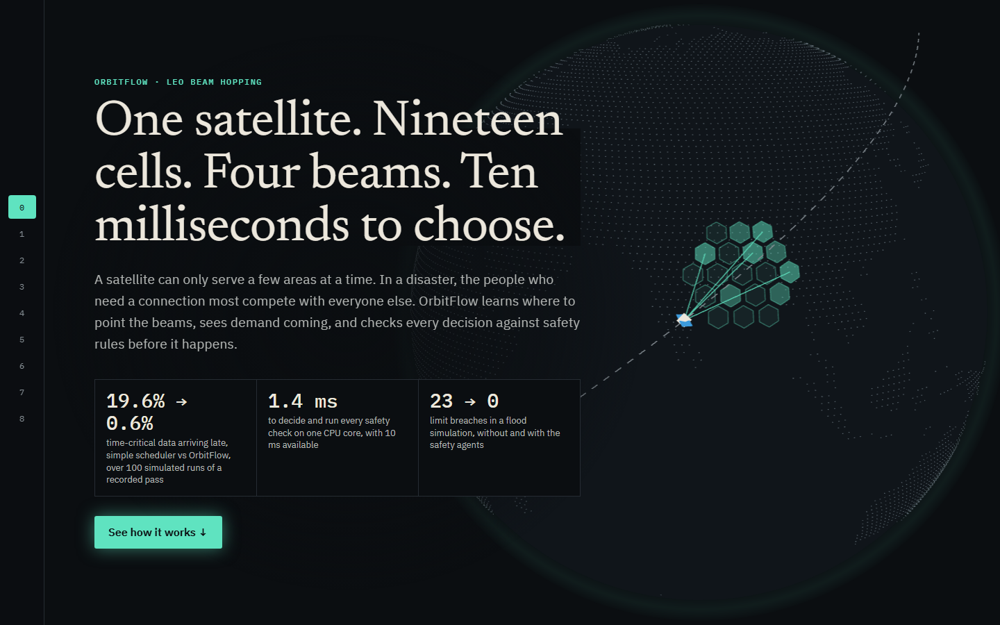
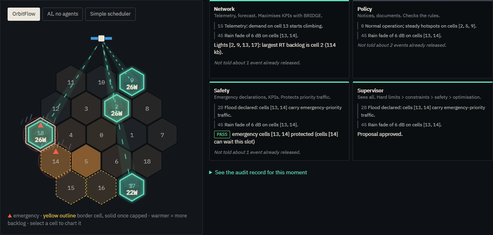
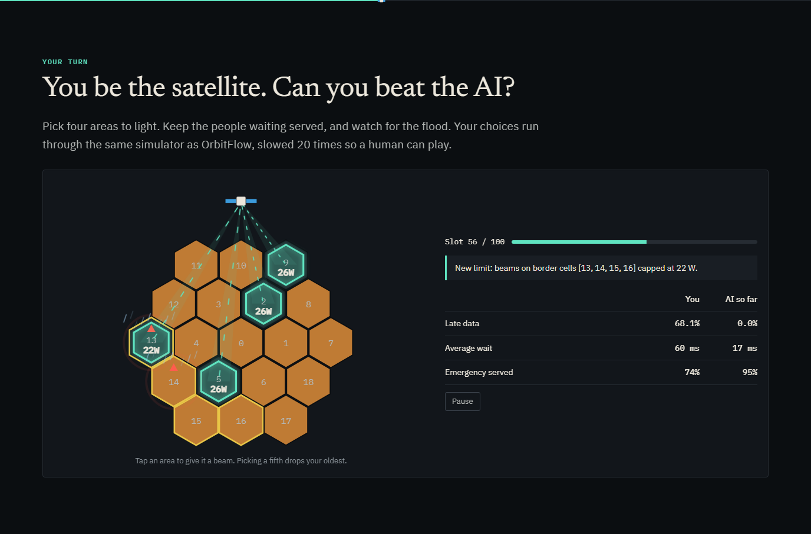
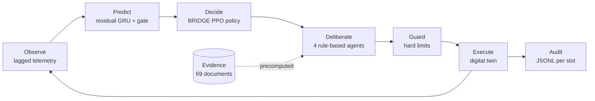

# OrbitFlow

**Learned, safety-checked beam hopping for a LEO satellite, with every decision audited.**

[](#testing)
[](https://www.python.org/)
[](https://pytorch.org/)
[](https://react.dev/)
[](LICENSE)

A satellite can light only 4 of its 19 ground cells in each 10 ms slot, on a 100 W budget. During a disaster, the people who most need a link compete with everyone else under the footprint.

OrbitFlow forecasts demand, chooses beams with a reinforcement-learned policy, and checks each decision against hard limits and operating constraints before it runs. Every slot is written to an audit log, and rule evidence is quoted word for word from real ITU and FCC documents.

> OrbitFlow is a research simulation built on offline datasets. It does not connect to a satellite or run in a live network.



## Contents

- [Key results](#key-results)
- [Quick start](#quick-start)
- [What's in the app](#whats-in-the-app)
- [How it works](#how-it-works)
- [API](#api)
- [Reproducing the results](#reproducing-the-results)
- [Testing](#testing)
- [Project layout](#project-layout)
- [Configuration](#configuration)
- [Limitations](#limitations)
- [Documentation](#documentation)
- [References](#references)

## Key results

Measured on 100 paired test episodes, averaged over 5 independently trained models. None of these episodes were used in training or model selection.

| Recorded pass | Late time-critical data | Mean delay | Throughput | Beam switches per slot |
|---|---:|---:|---:|---:|
| Fixed rotation | 1.95% | 98.0 ms | 117.4 Mbps | 4.00 |
| Reactive greedy | 19.64% | 16.1 ms | 169.4 Mbps | 1.69 |
| Hand-written rule | 0.76% | 30.8 ms | 166.4 Mbps | 3.80 |
| Behaviour clone | 0.76% | 32.3 ms | 167.1 Mbps | 3.80 |
| BRIDGE, no forecast | 0.46% | 18.4 ms | 169.2 Mbps | 3.67 |
| **BRIDGE** | **0.57%** | **15.9 ms** | **169.6 Mbps** | **3.44** |

BRIDGE beat Reactive on late data in 100 of 100 paired episodes (Wilcoxon signed-rank, Holm-corrected p < 0.001, rank-biserial r = −1.0).

| Other measures | Result |
|---|---|
| Second dataset (OpenNTN demand, Sionna-derived channel) | Late data 13.7% → 2.0% against Reactive |
| Flood scenario, 30 runs | Breaches of a test power limit: 22.9 slots → 0 with agents |
| Emergency deadlines in that flood scenario | None missed |
| Forecast error at gradual demand surges | 71% lower than repeating the last value |
| Decision plus safety checks | 1.43 ms mean, 2.16 ms p99, on one CPU core |
| Knowledge base | 69 documents, 4,105 pages, 46 of 46 checked citations verbatim |

### Trade-offs

- **Scarce capacity:** BRIDGE still misses fewer deadlines, but its average delay is worse than Reactive's (36.1 vs 25.6 ms at 150% traffic).
- **Beam switching:** it switches about twice as often as Reactive, and the simulator doesn't charge for switching.
- **Emergency volume:** in the flood, agents deliver slightly less total emergency data than no agents (94% vs 96%). Their gain is keeping to the limit.
- **Forecasting:** it barely helps on abrupt demand jumps (2%), and its delay benefit isn't fully explained.

The full statistics are in [docs/REPORT.md](docs/REPORT.md).

## Quick start

Trained models and results are included, so you don't need to train anything to run the app.

**Prerequisites:** Python 3.11+ and Node.js 18+, or Docker.

### Local

```bash
pip install -r requirements.txt

cd dashboard/frontend
npm install
npx vite build
cd ../..

python -m uvicorn dashboard.api:app --port 8000
```

Open <http://localhost:8000>.

### Docker

```bash
docker compose up --build
```

Open <http://localhost:8000>. The first build downloads PyTorch and takes several minutes.

### Static only

The story, game and precomputed results need no server:

```bash
cd dashboard/frontend
npx vite build
npx vite preview --port 4173
```

The "Ask anything" and "Run it live" features need the API. They switch off, and show the command to start it, when it isn't running.

## What's in the app

| Chapter | What you see |
|---|---|
| The problem | 3D globe with the beams the model chose |
| Three ways to choose | The same demand under three schedulers, and 100-dot comparison of late data |
| Seeing demand coming | Forecast against actual demand |
| How it decides | The decision chain, with measured timing |
| A flood, second by second | Scrubbable replay of what each agent knew, with an audit record per slot |
| **Your turn** | Play the satellite against the AI, on the same physics |
| Does it work? | Multi-run results, stress conditions and ablations |
| Try it yourself | What-if grid over 30 precomputed runs, plus new live simulations |
| The rulebook | Ask the documents in your own words and get exact quotations |
| How we know | Where each kind of number comes from |

| | |
|---|---|
|  |  |

## How it works



| Component | Approach |
|---|---|
| **Forecaster** | GRU that learns corrections to repeating the last value. It predicts 3 slots ahead, and falls back when its recent error is high. A leak test proves future demand can't affect it. |
| **BRIDGE** | Permutation-equivariant actor-critic trained with PPO. Gumbel-Top-K samples beams with an exact Plackett-Luce probability, and a Dirichlet splits power. About 38,600 parameters. |
| **Agents** | Network, Policy, Safety and Supervisor, each seeing only its own events. These are deterministic rules, chosen so time-critical decisions stay predictable. There is no LLM in the system. |
| **Guard** | Enforces beam count, power budget, power floor, signalling deadlines and caps. It runs in every configuration, and raw model output never reaches the twin. |
| **Knowledge base** | Section-aware chunks with page numbers and checksums. BM25 was the best retriever tested. A quote that isn't verbatim in its source is dropped, and off-topic questions are refused. |
| **Digital twin** | Slot-level queues with real-time priority, SINR with inter-beam interference, and KPI aggregation. |

Priority when rules conflict: hard limits, then operating constraints, then safety, then optimisation.

## API

Interactive docs are at <http://localhost:8000/docs> while the server runs.

| Method | Path | Purpose |
|---|---|---|
| `GET` | `/api/health` | Service and model status |
| `POST` | `/api/simulate?cap_w=22&fade_db=6&seed=42&agents=true` | Run the flood scenario through the full pipeline |
| `POST` | `/api/ask?q=...` | Grounded answer from the knowledge base, as quotations only |
| `GET` | `/api/results/{name}` | Any result file, such as `multirun` or `kb_report` |

```bash
curl -X POST "http://localhost:8000/api/ask?q=What%20is%20an%20ML%20sandbox%3F"
```

Limits: `cap_w` must be between 2 and 100, `fade_db` between 0 and 20, and `q` at most 500 characters. Out-of-range values return `422`.

## Reproducing the results

All runs use CPU and fixed seeds. Times are approximate, from a 16-core desktop.

```bash
pip install -r requirements.txt

# 1. Fetch and index the documents (not redistributed in this repository)
python scripts/fetch_kb.py
python -m rag.ingest
python -m rag.eval_retrieval --build-dense
python scripts/build_kb_report.py

# 2. Train the forecaster (about 6 min)
python -m traffic.train_forecaster

# 3. Train BRIDGE and its control, 5 seeds each (about 10-15 min per run; parallelise if you can)
for s in 1 2 3 4 5; do
  python -m bridge.train_ppo --tag rg_s$s --seed $s
  python -m bridge.train_ppo --tag rgnf_s$s --seed $s --no-forecast
done

# 4. Evaluate
python scripts/run_experiments.py --tag rg --gate    # multi-run matrix
python scripts/run_studies.py --tag rg               # emergency, factorial, flux density, latency, stress, sensitivity
python scripts/run_eval.py                           # replay and what-if grid; copies data to the UI

# 5. Rebuild the UI
cd dashboard/frontend && npx vite build
```

`scripts/run_eval.py` loads `models/bridge_ppo.pt`, which is a copy of the seed-3 checkpoint `models/exp/bridge_ppo_rg_s3.pt`. Copy your own checkpoint there after retraining.

For a quick smoke run, add `--fast` to the training commands and `scripts/run_eval.py`.

## Testing

```bash
python -m pytest -q tests
```

| Area | What the tests check |
|---|---|
| Digital twin and channel | Queue conservation, SINR behaviour, capacity boundaries |
| Link budget | FSPL and noise reference values, agreement with an independent budget |
| Guard | Every hard limit, under random proposals |
| Forecasting | No leakage from future demand, serialisation, gate causality |
| BRIDGE | Sampler matches its probability, action validity, inference time |
| Agents | Information boundaries, full audit coverage, emergency priority |
| Knowledge base | Provenance, verbatim citations, unsupported and off-topic questions |
| API | Health, error handling, repeatable simulations, grounded answers |
| Game | JavaScript physics reproduces recorded Python runs |

## Project layout

```
agents/         Network, Policy, Safety, Supervisor; policy_rules.yaml
audit/          Per-slot JSONL records
bam/            Guard: hard limits and repair
bridge/         BRIDGE policy, PPO and behaviour cloning, baselines
dashboard/      FastAPI server and React story UI
data/raw/       Offline NTN datasets
digital_twin/   Queues, SINR, KPIs, explicit link budget
docs/           Report, demo script, parameter sheet, provenance
models/         Trained checkpoints
rag/            Ingestion, retrieval, citation checks, manifest, index
results/        Every number the UI shows
scenarios/      Event engine with information boundaries, flood scenario
scripts/        Experiments, studies, evaluation, document fetch
tests/          Test suite
traffic/        Forecaster, synthetic demand, dataset splits
utils/          Config and statistics helpers
```

## Configuration

All tunables are in [`config.yaml`](config.yaml):

| Section | Controls |
|---|---|
| `scenario` | Cells, beams, power budget, telemetry lag |
| `link` | Radio parameters |
| `queues`, `timing_guard` | Buffers, delay budgets, signalling limits |
| `reward`, `bridge`, `predictor` | Training |
| `demo`, `emergency`, `agents` | Flood scenario and agent behaviour |
| `rag` | Retrieval and evidence thresholds |

If you change `link`, rerun the experiments and studies.

## Limitations

- **Simulation:** the system uses offline dataset exports. It doesn't run Sionna or OpenNTN live, and it has no real-time guarantees.
- **Radio parameters:** antenna gain, bandwidth, isolation and noise figure are provisional engineering values. See the [parameter sheet](docs/link_budget_parameters.md).
- **Scenarios:** training demand is generated, calibrated to the dataset. The flood, rain fade and 22 W limit are test conditions, not real events or law.
- **One geometry:** all runs share one compressed pass, so other orbits are untested. Second-dataset runs reuse it too.
- **Not modelled:** beam-switching overhead, MCS tables (capacity uses the Shannon bound), polarisation and implementation losses, multi-satellite handover.
- **Regulatory:** the SF.358-5 study is indicative, because a 20 GHz carrier falls outside its listed bands. OrbitFlow makes no compliance claim, and its citations haven't had legal review.
- **Knowledge base:** two source PDFs couldn't be extracted, and the Radio Regulations, 3GPP and O-RAN texts aren't included.

## Documentation

| Document | Contents |
|---|---|
| [docs/REPORT.md](docs/REPORT.md) | Full results, statistics, blocker register and readiness checklist |
| [docs/demo_script.md](docs/demo_script.md) | Three-minute demo and likely questions |
| [docs/link_budget_parameters.md](docs/link_budget_parameters.md) | Every radio parameter, its source and status |
| [docs/data_provenance.md](docs/data_provenance.md) | Datasets, model inputs and splits |
| [`rag/knowledge_base/manifest.yaml`](rag/knowledge_base/manifest.yaml) | Every document, with checksum and source |

## References

- Schulman et al., "Proximal Policy Optimization Algorithms", 2017.
- Kool et al., "Stochastic Beams and Where to Find Them", ICML 2019.
- Cho et al., "Learning Phrase Representations using RNN Encoder-Decoder", 2014.
- ITU-T Y.3172, machine learning in future networks.
- ITU-R SF.358-5, power flux-density limits.
- ITU, *AI Ready: Analysis Towards a Standardized Readiness Framework*, Report 2.0, 2026.

## Acknowledgements

The knowledge base draws on the [ITUAIReadiness](https://github.com/CrashingGuru/ITUAIReadiness) document repository (MIT licence), along with ITU-R and FCC publications.

## License

Code is released under the [MIT License](LICENSE). Knowledge-base documents keep their publishers' terms. They are fetched by `scripts/fetch_kb.py` and aren't redistributed here.
