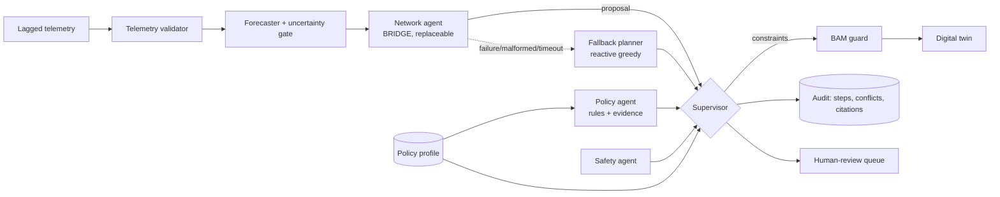

# OrbitFlow operations layer

This document covers the parts added on top of the core pipeline: coordination and failure handling, the agent registry, policy profiles, the knowledge catalogue, multilingual input and output, the scenario suite, and the standards and AI-readiness mappings. The core (forecaster, BRIDGE, guard, digital twin, retrieval) is described in [REPORT.md](REPORT.md).

Everything here runs in simulation. No claim of regulatory compliance, standards conformance or real-world deployment is made.

## 1. Architecture



Fixed precedence when outputs disagree: **hard limits > operating constraints > safety > optimisation.** It is fixed in code, not negotiated.

### Why these are agents and the rest are components

| Part | Kind | Why |
|---|---|---|
| Network | agent | Makes the optimisation decision; replaceable (`bridge_ppo`, `heuristic_predictive`, `reactive_greedy`) |
| Policy | agent | Has its own information boundary (policy notices) and its own evidence |
| Safety | agent | Has its own information boundary (emergency declarations) |
| Supervisor | agent | Coordinates, detects conflicts, applies fallbacks, escalates |
| Forecaster, telemetry validator, guard, explainer | components | Deterministic functions with no decision of their own; making them "agents" would add nothing |

There is no LLM anywhere. Every agent is deterministic, so decisions are reproducible from the seed.

## 2. Coordination, failure handling and conflicts (`agents/supervisor.py`)

| Situation | Detection | Response |
|---|---|---|
| Network agent raises | exception | Reactive fallback proposes; slot marked `FALLBACK`; first slot of each episode is escalated |
| Malformed proposal | shape, finiteness and sign checks on every proposal | Same as above |
| Timeout | injected (`timeout`) | Same as above. A real wall-clock overrun is **counted, not acted on**, because acting on it would make runs non-reproducible |
| Policy agent down | exception | Fail-closed: the profile's `fail_closed_cap_w` applies to border cells even before a notice arrives |
| Safety agent down | exception | Every declared emergency cell is forced on |
| Invalid telemetry (NaN, negative) | validator | Last good value imputed; that cell's forecast replaced by persistence |
| Stale telemetry | report age > 3 slots | As above. Above `max_bad_telemetry_share` the whole forecast is dropped (conservative mode) and escalated |
| Network vs policy | proposal exceeds cap | Guard reduces power |
| Network vs safety | required cell left dark | Cell forced on |
| Policy vs safety | cap on a protected emergency cell | Resolved by the profile's exemption mode |
| State drift | demand at execution differs from the observation by more than `state_drift_mbps` | Recorded; the decision was already made on lagged data |

Each run returns `coordination` with per-agent health (calls, failures, fallbacks, by kind), conflicts by type, data-quality counts and human reviews by kind. Each audit record carries `conflicts` and the trace steps for failures and validation.

With no profile and no faults, the Supervisor reproduces the original published results exactly (`tests/test_policy_profiles.py::test_baseline_profile_reproduces_the_original_system`).

## 3. Agent registry (`agents/registry.yaml`)

Each entry declares its kind, technique, version, inputs, outputs, allowed and prohibited actions, failure modes, fallback and timeout. The Supervisor reads `enabled` (Policy and Safety can be switched off), `fallback`, and the Network implementation. Entries marked `required` (guard, Network agent, Supervisor, validator) cannot be disabled; the loader rejects such a file.

The permission lists are partly enforced in software (information boundaries in `scenarios/engine.py`; the guard is always run) and partly documentation. They are not a sandbox.

## 4. Policy profiles (`policy/`)

Three profiles ship, all marked `ILLUSTRATIVE`:

| Profile | Cap | Emergency exemption | Escalation | Evidence |
|---|---|---|---|---|
| `baseline-intl` | 22 W on cells 13–16 | human approval | 5-slot shortfall | ITU-T Y.3172, ASEAN guide (via rules R3, R6, R7) |
| `ae-demo` (UAE-oriented) | 16 W | never | 3-slot shortfall, fail-closed 12 W | **No UAE document is in the corpus**; all values illustrative |
| `in-demo` (India-oriented) | 22 W | automatic | 5-slot | NITI Aayog *Principles for Responsible AI* (accountability, p.50). The exemption has **no** supporting passage (R5); the validator warns about this |

None of these represents a country's law. Each records its provenance, version, effective date, fingerprint and a source type per rule (`official`, `research`, `illustrative`, `assumption`).

`policy.engine.validate()` checks the schema and ranges and detects conflicts: a cap below the per-beam floor, a fail-closed cap looser than the normal cap, cap versus emergency cells (with the stated resolution), and an unsourced exemption. Where a knowledge base is available it also reports evidence status for each rule.

What a profile changes: the cap notice (cells, value, onset), the exemption mode, safety thresholds, escalation triggers and fail-safe values. What it never changes: the forecaster, BRIDGE or the guard.

To add a profile, copy a YAML file in `policy/profiles/`, give it a new `profile_id`, and check it with `POST /api/policy/validate` or `python -c "from policy.engine import *; ..."`. No code change is needed.

## 5. Knowledge base and catalogue

The document corpus, retrieval and verbatim-citation checks are unchanged (see REPORT.md §B). `knowledge/catalog.yaml` lists every machine-readable knowledge file, its provenance and its consumers; `tests/test_mappings.py` checks that the paths exist. Profiles consume the knowledge base: governance rules carry evidence status and quotes, computed at validation.

## 6. Multilingual input and output (`i18n/`)

- **Input:** `i18n/interpret.py` detects the script (Arabic, Devanagari, Tamil, otherwise English), normalises native digits and Arabic letter forms, and matches a keyword lexicon (`lexicon.yaml`) to a structured intent `{scenario_id, profile_id, params}`. **It is a lexicon, not language understanding**; unmatched text is reported as not understood, never guessed.
- **Processing:** language-independent. The same request in four languages produces identical KPIs (scenario S8).
- **Output:** `i18n/explain.py` fills localised templates only with numbers taken from the result. Missing keys fall back to English.
- **UI:** the Operations console is localised (en, ar, hi, ta) with RTL layout for Arabic. Technical source text (scenario definitions, rules, standards) and the original story chapters remain English.
- **Translation quality:** Arabic, Hindi and Tamil strings were written by the developer and **have not been reviewed by native speakers**.

To add a language, add `i18n/locales/<code>.json` with the same keys (`tests/test_i18n.py` checks key and placeholder parity), add lexicon words, add the code to `SUPPORTED` in `i18n/explain.py` and to `LANGS` in `Console.jsx`, then run `scripts/run_suite.py`.

## 7. Scenarios and simulation (`scenarios/suite.yaml`)

| ID | Scenario | What is injected | Key checks |
|---|---|---|---|
| S1 | Normal | synthetic `normal` demand | no fallback; late data ≤ reactive |
| S2 | Surge | synthetic `event_surge` | forecast MAE < repeat-last |
| S3 | Congestion | flood ×1.5 traffic, 9 dB fade | 0 cap breaches; shortfall escalated |
| S4 | Policy-restricted | same flood under three profiles | proposals identical before cap; India demo exempts, UAE demo doesn't |
| S5 | Uncertain prediction | 15 Mbps noise on forecaster output | gate falls back; gated MAE < raw |
| S6 | Agent failure | Network exception/malformed/timeout; Policy down | 15 fallback slots, fail-closed, escalated |
| S7 | Conflicting agents | 12 W cap on emergency cells | conflicts typed and resolved; escalated |
| S8 | Multilingual | same request in en/ar/hi/ta | same intent, identical KPIs |
| S9 | Cross-context | 2 traffic contexts × 3 profiles | identical in normal traffic; differ in flood |
| S10 | Data failure | NaN, stale (10 cells), negative telemetry | detected, imputed, conservative mode, escalated |

Each result records the description, what is simulated, the expectation (written before the run), checks with expected and actual values, KPIs against two baselines on the identical trace (Reactive greedy + guard; BRIDGE + guard without agents), a no-fault reference where relevant, forecast metrics against simulated ground truth, decision traces, localised explanations, limitations, and checksums of the config and both checkpoints.

What is real: one recorded LEO pass geometry and its channel. Everything else is simulated: demand, the flood, the cap, the faults and the profiles.

```bash
python scripts/run_suite.py                       # all ten, about 35 s
python scripts/run_suite.py --only S6_agent_failure
```

To add a scenario, add an entry to `suite.yaml` (bases: `synthetic`, `flood`; options: `profiles`, `faults`, `forecast_noise`, `reference`) with `checks` written as dotted metric paths.

## 8. Validation

`python -m pytest -q tests` runs the original suite plus `test_policy_profiles`, `test_resilience`, `test_registry`, `test_i18n`, `test_scenarios`, `test_mappings` and `test_api_ops`. The Validation tab lists every test file and its test count, read from source.

Honest notes from the suite:

- In S1 and S2 both OrbitFlow and the reactive baseline deliver all time-critical data on time, so single episodes do not separate them. The 100-episode statistics in REPORT.md do.
- At 150% traffic (S3) the forecaster's one-step error, 0.94 Mbps, is worse than repeating the last value (0.42 Mbps). The gate catches only a little of it, so this load is out of distribution.
- With injected faults (S6, S10), emergency service was slightly higher than in the clean run (95.7% and 95.4% vs 93.1%). The reactive fallback and the conservative forecast happened to favour the emergency cells. This is not evidence that failures help.

## 9. Standards and AI readiness

- `knowledge/standards_map.yaml` has 14 entries (ITU-T Y.3172/3173/3174, ITU-R SF.358-5, S.1503-4, S.524-8, 3GPP TR 38.811/38.821, TS 38.300/38.213 NTN, DVB-S2X beam hopping, O-RAN E2, ISO/IEC 42001, NIST AI RMF, FCC 26-26). Each entry has a status (`implemented_in_simulation`, `partial`, `conceptual`, `proposed`, `not_implemented`, `not_applicable`), evidence paths, what is not implemented, and a next step. No entry is `implemented_in_simulation`; the strongest is `partial`. Editions not checked against the publisher are flagged `version_verified: false`.
- `knowledge/ai_readiness_map.yaml` maps the six factors of ITU *AI Ready* Report 2.0 (verbatim factor statements from `results/kb_report.json`) to components and evidence on a 0–5 maturity scale defined in the file. The highest score is 3, "tested in simulation"; nothing is externally validated.

## 10. API additions

| Method | Path | Purpose |
|---|---|---|
| GET | `/api/scenarios` | Suite definitions |
| POST | `/api/scenarios/{id}/run?seed=` | Execute a scenario |
| GET | `/api/policy/profiles`, `/api/policy/profiles/{id}` | Profiles and their validation |
| POST | `/api/policy/validate` | Validate a custom profile (JSON body) |
| POST | `/api/policy/run?profile=&cap_w=&exemption=&fade_db=&seed=` | Flood under a (customised) profile |
| POST | `/api/interpret?text=&run=true` | Multilingual request → intent → run → localised explanation |
| GET | `/api/agents`, `/api/governance`, `/api/i18n/{lang}` | Registry, governance bundle, locale |

## 11. Extending

- **Replace the Network agent:** add a branch to `agents/registry.py:build_network_policy` that returns a `Policy` with `act(obs) -> Action`, then set `implementation` in the registry.
- **Change a fallback:** `fallback` in the registry (`reactive_greedy`, `static_round_robin`).
- **Replace the forecaster:** any object with `predict_trace(trace, lag)` returning `(T, N, 3)` works in `scenarios/suite.py:forecast_for`. Keep the leak test passing.
- **Another network environment:** provide a `Trace` (see `traffic/dataset.py`). The twin, agents and suite are agnostic to its source; `n_cells` and `k_beams` come from `config.yaml`.

## 12. Why "BRIDGE + guard, agents off" looked better, and what was fixed

**Symptom.** In the flood scenarios the baseline without agents showed lower delay and less late data than full OrbitFlow (for example 17.7 vs 19.6 ms mean delay over 30 seeds).

**Decomposition** (30 flood seeds, same traces, baseline profile):

| Variant | Mean delay | Late RT data | Emergency served | Cap breaches | Delay, slots 28–49 (before any cap) |
|---|---:|---:|---:|---:|---:|
| BRIDGE alone | 17.67 ms | 0.06% | 92.6% | **21.2** | 14.5 ms |
| OrbitFlow, before fix | 19.58 ms | 0.15% | 92.5% | 0 | 17.3 ms |
| OrbitFlow, after fix | **18.47 ms** | **0.09%** | 92.5% | 0 | **15.3 ms** |
| BRIDGE + guard + cap only (after fix) | 18.38 ms | 0.09% | 91.3% | 0 | 14.9 ms |

**Root cause (a bug).** With agents on, the Supervisor marks emergency cells as *protected* for the guard. The guard's proactive-signalling scheduler (`BamGuard._due`) subtracted **every** protected cell from the beams available for SSB/SIB service, lit or not. With two emergency cells, it assumed two beams instead of four, doubled its reserve and forced signalling beams far earlier than needed, overriding BRIDGE. BRIDGE had been trained against the four-beam reserve, so its proposals kept being repaired. The cost showed before any cap existed (slots 28–49).

**Fix.** `bam/validator.py`: only protected cells that actually hold a beam this slot (proposed or forced) reduce signalling capacity. Hard deadlines are unchanged; expired cells are still mandatory, and the randomized guard tests still pass.

**What remains, and why it should remain.**
- **The cap (slots 50–60).** Obeying a 22 W operating constraint costs capacity. BRIDGE alone is faster there only because it breaks the cap in about 21 slots per run. It is not a compliant alternative, and the suite now labels it "cap NOT enforced".
- **The Safety agent's need-based emergency forcing.** Sweeping its trigger (0.2–0.6 of the delay budget) trades about 0.5 ms of mean delay against about 2 points of emergency service. The default (0.3) keeps emergency RT violations at 0 with the best service among compliant variants.

**Fairer comparisons in the suite.** Baselines now face the same injected telemetry and network faults as OrbitFlow (previously only OrbitFlow was faulted in S6/S10). A compliant baseline "BRIDGE + guard, cap enforced" is added. Among controllers that respect the cap, OrbitFlow serves the most emergency traffic.
